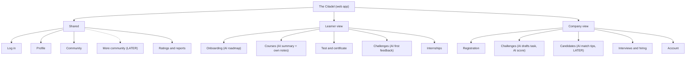
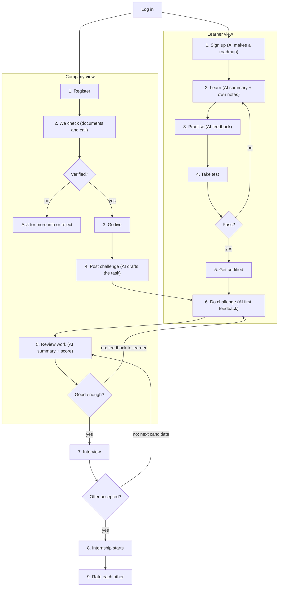

# The Citadel: User Flow and Information Architecture

Tagline: Skills that get you in
Product type: Web app (one login, role-based views)
Users: young people aged 18–30 in Myanmar (other Asian countries later), and IT companies.

Diagram images for reference: `citadel-user-flow.svg` and `citadel-ia-tree.svg` (PNG copies included).

## 1. How the app is organised

- One web app, one login. After login the user sees a **Learner view** or a **Company view**, depending on their role.
- Some sections are **Shared** by both roles.
- A company can only use its view fully after our team verifies it. Until then the company view is locked (registration screens only).
- Build the **first version** only. Items marked `LATER` are not built yet.
- `AI` marks a screen where AI is used.

## 2. Information architecture (site tree)

```
The Citadel (web app)
├── Shared
│   ├── Log in                 one login, role decides the view
│   ├── Profile                skills and certificates
│   ├── Community              course discussion, challenge posts (company posts, learner replies)
│   ├── More community         LATER: study groups, meetups, success stories
│   └── Ratings and reports    rate each other, report a post or user
├── Learner view
│   ├── Onboarding             career goal                          [AI: roadmap]
│   ├── Courses                lessons, quizzes, own notes          [AI: summary]
│   ├── Test and certificate   pass to get certified
│   ├── Challenges             company tasks, submit work           [AI: first feedback]
│   └── Internships            interview and start
└── Company view
    ├── Registration           apply, we verify, agree terms
    ├── Challenges             post a challenge, review work        [AI: drafts task, summary + score]
    ├── Candidates             certified learners                   [AI: match tips, LATER]
    ├── Interviews and hiring  interview, then offer
    └── Account                company page, verified badge
```



## 3. User flow



### Flow in words

**Learner**
1. Sign up and set a career goal. AI makes a roadmap of courses.
2. Learn the course. AI gives a summary; the learner can also write their own notes.
3. Practise with quizzes and AI feedback.
4. Take the test. If not passed, go back to Learn.
5. If passed, get certified.
6. Do a company challenge. AI gives first feedback before the company reviews it.

**Company**
1. Register with company details.
2. Our team checks documents and holds a short call.
3. If not verified: ask for more info or reject. If verified: go live (Verified badge).
4. Post a challenge. AI drafts the task from the skill needed.
5. Review submitted work, with an AI summary and score.
6. If not good enough: feedback goes to the learner, who tries again. If good: go to interview.

**Shared**
7. Interview between company and learner.
8. If the offer is not accepted, the company goes back to review the next candidate. If accepted, the internship starts.
9. Both sides rate each other.

## 4. Rules the app must enforce

- Learners never pay to apply, take a challenge or interview.
- Only verified companies can post challenges, internships or community posts as a company.
- AI pre-screens and supports; the company makes every hiring decision.
- Community: free for everyone; every post has a Report button; no sharing challenge answers; no private contact details in posts.
- Company challenge unlocks only after the learner finishes the course.

### Community → Challenge tab

Company view
- A verified company can add a challenge post for its own challenge.
- The post has a title, the challenge it belongs to, and a short message, such as notes, rules or a question for learners.
- The post shows the company name and the Verified badge.

Learner view
- A learner can view every challenge post from verified companies.
- A learner can reply to a challenge post with a question or a comment.
- The company's reply is marked "Official answer".

Rules
- Only verified companies can add challenge posts.
- Learners do not share their challenge solutions in replies. Solutions are submitted in Challenges, not in Community.
- No private contact details in posts or replies.
- Every post and reply has a Report button.

## 5. Learning access (suggested, to confirm)

| What | Free | Paid track |
|---|---|---|
| Career starter course | All lessons, quizzes, AI notes, certificate | n/a |
| First 25% of each paid course | Lessons, quizzes, AI notes and summaries | n/a |
| Last 75% of each paid course | Locked | Included |
| Final test and certificate | Career starter only | Included |
| Company challenge | Locked until the course is done | Included, no extra charge |
| Internship application and interview | Always free | Always free |
| Community | Free | Free |

## 6. Roles and access (suggested, to confirm)

| Screen group | Learner | Company (verified) | Company (not verified) |
|---|---|---|---|
| Shared (profile, community, ratings) | Yes | Yes | Profile only |
| Learner view | Yes | No | No |
| Company view | No | Yes | Registration only |

## 7. Later (do not build now)

- Mentorship: 1:1 sessions, mentor matching, priced like ADPList (flat 10% fee from the mentor, paid after the session).
- More community: study groups, online meetups, success stories.
- AI match tips for companies.
- Other Asian countries.
