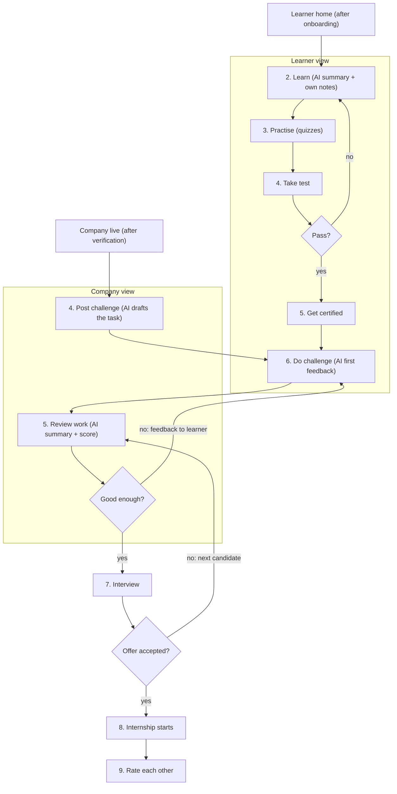

# The Citadel: User Flow and Information Architecture

Tagline: Skills that get you in
Product type: Web app (one login, role-based views)
Users: young people aged 18–30 in Myanmar (other Asian countries later), and IT companies.

Diagram images for reference: `citadel-user-flow.svg` and `citadel-ia-tree.svg` (PNG copies included).

## 1. How the app is organised

- One web app, one login. After login the user sees a **Learner view** or a **Company view**, depending on their role.
- Some sections are **Shared** by both roles.
- A company can only use its view fully after our team verifies it. Until then the company view is locked (registration screens only).
- Build the **first version** only. Items marked `LATER` are not built yet.
- `AI` marks a screen where AI is used.

## 2. Information architecture (site tree)

```
The Citadel (web app)
├── Shared
│   ├── Sign up                choose role, accept terms (18+), confirm email
│   ├── Log in                 one login, role and status decide where you land
│   ├── Profile                skills and certificates
│   ├── Community              course discussion, challenge posts (company posts, learner replies)
│   ├── More community         LATER: study groups, meetups, success stories
│   └── Ratings and reports    rate each other, report a post or user
├── Learner view
│   ├── Onboarding             language, goal or "not sure", roadmap review, profile  [AI: roadmap]
│   ├── Courses                lessons, quizzes, own notes          [AI: summary]
│   ├── Test and certificate   pass to get certified
│   ├── Challenges             company tasks, submit work           [AI: first feedback]
│   └── Internships            interview and start
└── Company view
    ├── Registration           details, documents, agree terms, status, resubmit
    ├── Challenges             post a challenge, review work        [AI: drafts task, summary + score]
    ├── Candidates             certified learners                   [AI: match tips, LATER]
    ├── Interviews and hiring  interview, then offer
    └── Account                company page, verified badge (checked once live)
```



```mermaid
flowchart TD
  root["The Citadel (web app)"]
  root --> shared["Shared"]
  root --> learner["Learner view"]
  root --> company["Company view"]
  shared --> s0["Sign up"]
  shared --> s1["Log in"]
  shared --> s2["Profile"]
  shared --> s3["Community"]
  shared -.-> s4["More community (LATER)"]
  shared --> s5["Ratings and reports"]
  learner --> l1["Onboarding (language, goal, AI roadmap, review, profile)"]
  learner --> l2["Courses (AI summary + own notes)"]
  learner --> l3["Test and certificate"]
  learner --> l4["Challenges (AI first feedback)"]
  learner --> l5["Internships"]
  company --> c1["Registration (details, documents, terms, status)"]
  company --> c2["Challenges (AI drafts task, AI score)"]
  company --> c3["Candidates (AI match tips, LATER)"]
  company --> c4["Interviews and hiring"]
  company --> c5["Account"]
```

## 3. User flow

### 3.1 Getting in: sign up, log in and onboarding

```mermaid
flowchart TD
  land["Landing page"] --> has{"Have an account?"}
  has -- yes --> login["Log in"]
  has -- no --> su["Sign up: choose role, name, email, password"]
  su --> terms["Accept terms and privacy, confirm age 18+"]
  terms --> otp["Confirm email with a one-time code"]
  otp --> role{"Learner or company?"}

  role -- learner --> lang["Choose language (English / Burmese)"]
  lang --> goal{"Know your career goal?"}
  goal -- yes --> g1["Pick goal, current skills, hours per week"]
  goal -- not sure --> g2["Hours per week"]
  g1 --> ai["AI builds the roadmap (loading; retry if it fails)"]
  g2 --> ai
  ai --> review["Review roadmap: free vs paid parts shown"]
  review -- change answers --> goal
  review -- accept --> prof["Basic profile: headline, skills (can skip)"]
  prof --> home["Learner home: roadmap, first course"]

  role -- company --> c1["Company details"] --> c2["Upload business documents"] --> c3["Internship terms + agree company rules"]
  c3 --> c4["Submit for verification"]
  c4 --> wait["Status: under review (email when done)"]
  wait --> call["Our team checks documents and holds a short call"]
  call --> cv{"Verified?"}
  cv -- needs more info --> fix["Edit registration and resubmit"] --> wait
  cv -- rejected --> rej["Status: rejected, with the reason"]
  cv -- yes --> live["Status: live (Verified badge)"]
  live --> page["Check company page"] --> first["Post first challenge"]

  login --> who{"Role and status"}
  who -- learner with roadmap --> home
  who -- learner without roadmap --> lang
  who -- company, not submitted --> c1
  who -- company, under review / needs info / rejected --> wait
  who -- company, verified --> first
```

Notes
- "Not sure yet" gives a roadmap of the free Career starter course only. The learner picks a goal later from the roadmap ("Change goal").
- The roadmap is saved only when the learner accepts it. Leaving before that restarts onboarding at the next login.
- Changing the goal later reruns only the goal and review steps.
- The first version (demo) has no passwords and shows the one-time code on screen. A real build sends the code by email (phone/SMS later).

### 3.2 Learning, challenges and hiring



### Flow in words

**Getting in (everyone)**
- New visitors sign up; returning users log in. Sign-up asks for the role (learner or company), name and email, then terms, privacy and age (18+), then a one-time code to confirm the email.
- After log in, the role and status decide the first screen: learner home or onboarding for learners; registration, status page or company home for companies.

**Learner**
1. Onboarding: choose a language, then a career goal (or "Not sure yet"), current skills and study hours. AI makes a roadmap of courses; the learner reviews it, sees which parts are free or paid, and accepts it or changes their answers. Then an optional basic profile.
2. Learn the course. AI gives a summary; the learner can also write their own notes.
3. Practise with quizzes.
4. Take the test. If not passed, go back to Learn.
5. If passed, get certified.
6. Do a company challenge. AI gives first feedback before the company reviews it.

**Company**
1. Register: company details, business documents, internship terms, and agree to the company rules.
2. Submit. The status page shows "under review"; our team checks documents and holds a short call, then emails the result.
3. If more info is needed: edit and resubmit. If rejected: the status page shows the reason. If verified: go live (Verified badge), check the company page.
4. Post a challenge. AI drafts the task from the skill needed.
5. Review submitted work, with an AI summary and score.
6. If not good enough: feedback goes to the learner, who tries again. If good: go to interview.

**Shared**
7. Interview between company and learner.
8. If the offer is not accepted, the company goes back to review the next candidate. If accepted, the internship starts.
9. Both sides rate each other.

## 4. Rules the app must enforce

- Learners never pay to apply, take a challenge or interview.
- Only verified companies can post challenges, internships or community posts as a company.
- AI pre-screens and supports; the company makes every hiring decision.
- Community: free for everyone; every post has a Report button; no sharing challenge answers; no private contact details in posts.
- Company challenge unlocks only after the learner passes the course test and is certified.
- Sign-up needs terms and privacy accepted, age 18+ confirmed, and a confirmed email.
- AI suggests the roadmap; the learner accepts or changes it before it is saved.

### Community → Challenge tab

Company view
- A verified company can add a challenge post for its own challenge.
- The post has a title, the challenge it belongs to, and a short message, such as notes, rules or a question for learners.
- The post shows the company name and the Verified badge.

Learner view
- A learner can view every challenge post from verified companies.
- A learner can reply to a challenge post with a question or a comment.
- The company's reply is marked "Official answer".

Rules
- Only verified companies can add challenge posts.
- Learners do not share their challenge solutions in replies. Solutions are submitted in Challenges, not in Community.
- No private contact details in posts or replies.
- Every post and reply has a Report button.

## 5. Learning access (suggested, to confirm)

| What | Free | Paid track |
|---|---|---|
| Career starter course | All lessons, quizzes, AI notes, certificate | n/a |
| First 25% of each paid course | Lessons, quizzes, AI notes and summaries | n/a |
| Last 75% of each paid course | Locked | Included |
| Final test and certificate | Career starter only | Included |
| Company challenge | Locked until the course is done | Included, no extra charge |
| Internship application and interview | Always free | Always free |
| Community | Free | Free |

## 6. Roles and access (suggested, to confirm)

| Screen group | Learner | Company (verified) | Company (not verified) |
|---|---|---|---|
| Shared (profile, community, ratings) | Yes | Yes | Profile only |
| Learner view | Yes | No | No |
| Company view | No | Yes | Registration only |

## 7. Later (do not build now)

- Mentorship: 1:1 sessions, mentor matching, priced like ADPList (flat 10% fee from the mentor, paid after the session).
- More community: study groups, online meetups, success stories.
- AI match tips for companies.
- Other Asian countries.
